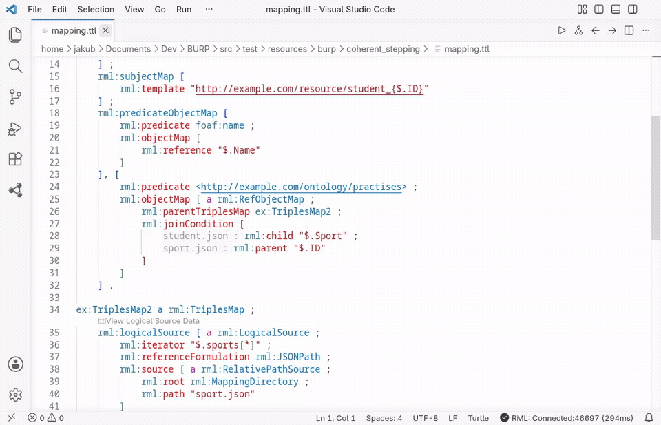
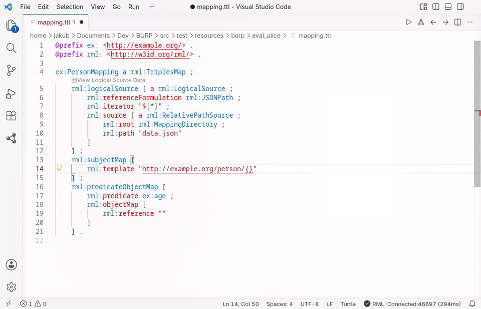
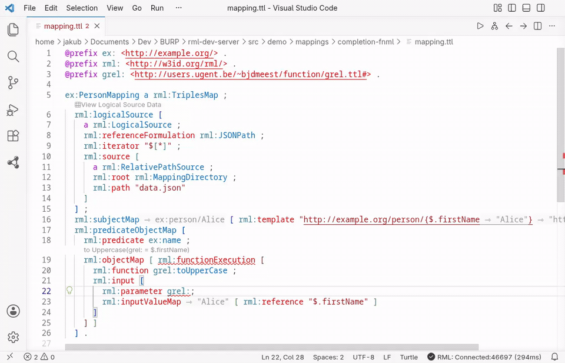
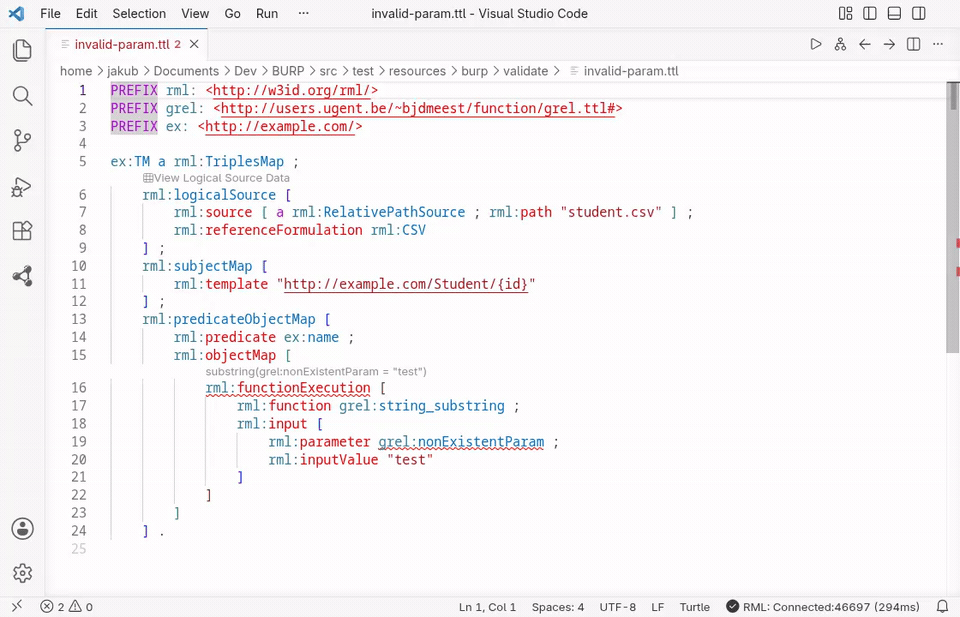
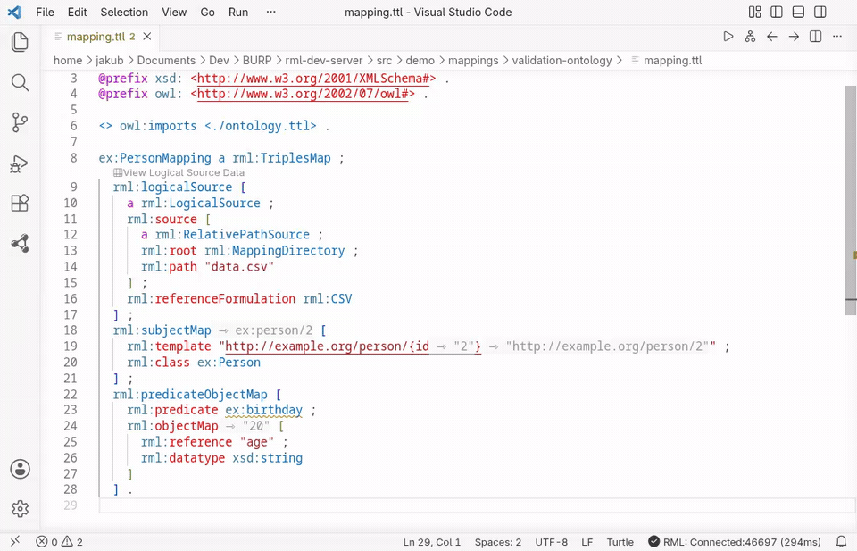
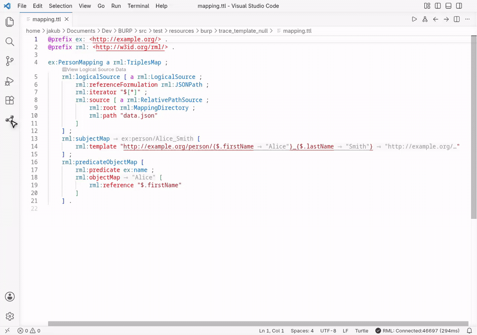
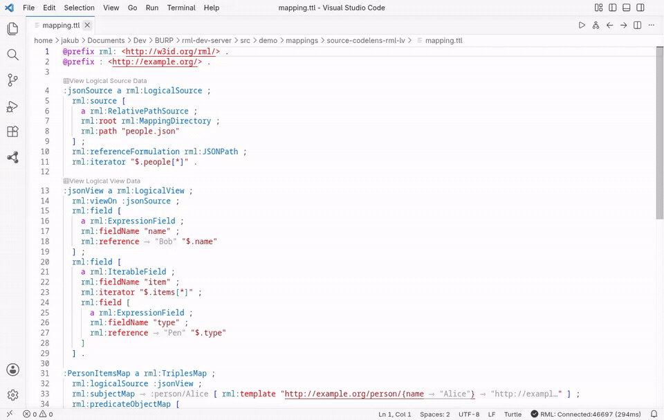
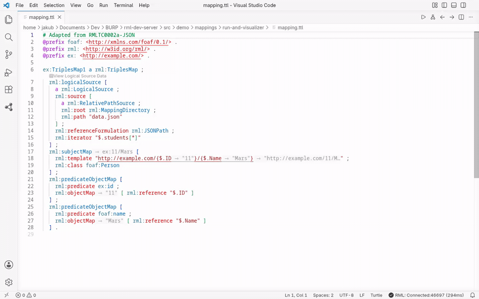
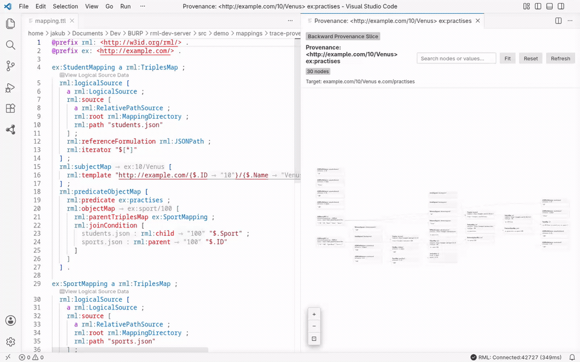

# RML Dev Server

A Visual Studio Code extension for the **RDF Mapping Language (RML)**, powered by the [BURP](https://github.com/kg-construct/BURP) RML processor.

## Features

- **Live Evaluation & Inline Hints**: Inspect evaluated terms and expressions inline within `.ttl` and `.rml` files, and
  step through source iterations (`Alt+[` / `Alt+]`).
- **Validation**: RML and FNML diagnostics, reference formulation checks, and optional OWL/RDFS ontology-backed term
  validation.
- **Autocompletion**: Context-aware RML/FNML vocabulary, function parameter, reference, and optional OWL/RDFS ontology
  term completion.
- **Evaluator & Value Inspector**: Interactively test selectors, expressions, and references against your data sources
  from the **RML Dev Server** sidebar.
- **Run Mapping & RDF Visualizer**: Execute mappings from the editor title bar and inspect the output in a filterable
  **Table** or interactive **Graph** view.
- **Dataflow & Provenance Tracing**: Trace iteration dataflow from source records or trace output quad provenance back
  to the mapping and input data.

## Demos

- **Live Inline Evaluation & Join Stepping**: Inspect evaluated terms inline and step coherently across joined mappings.

  

- **JSONPath Implicit-Schema Completion**: Autocomplete references with live sample values inferred directly from your
  data source.

  

- **FNML Parameter Completion & Short Syntax**: Complete function parameters and inspect inline evaluation of
  `rml:inputValue` shortcuts.

  

- **RML, FNML & Ontology Validation**: Catch invalid references, function parameter errors, and ontology
  predicate/datatype mismatches directly in the editor.

  

  

- **Evaluator & Value Inspector**: Test single iterations, inspect multi-record warnings, and evaluate custom reference
  values in the sidebar.

  

- **RML-LV & Source Data CodeLens**: Preview Logical Views and original Logical Sources directly from editor CodeLenses.

  

- **Run Mapping & RDF Visualizer**: Execute mappings, inspect results grouped by iteration, and explore the interactive
  RDF Graph.

  

- **Quad Provenance Tracing**: Trace any generated output quad back to its mapping rules and source iteration.

  

## Getting Started (First-Start Setup)

1. Install the extension from
   the [VS Code Marketplace](https://marketplace.visualstudio.com/items?itemName=uliege-dre.rml)
   or [Open VSX](https://open-vsx.org/extension/uliege-dre/rml).
2. Open any `.ttl` or `.rml` mapping file. The bundled BURP Dev Server starts automatically.
3. **Java 21+ Runtime**: BURP requires Java 21 or newer.
    - If Java 21+ is already on your `PATH`, it is detected automatically.
    - If not found, the extension prompts you with **Configure Java** to select an existing installation or
      automatically download a compatible JRE (Eclipse Temurin JRE 25) into extension storage.
    - You can also set `rml.java.path` in Settings to point to a specific `java` executable.
4. **Base IRI (Optional)**: If your mapping generates relative IRIs, set `rml.baseIRI` in VS Code Settings.

All other settings can be browsed and configured directly in the VS Code Settings UI (search for `@ext:uliege-dre.rml`).

## Telemetry

This extension collects anonymous usage telemetry (via [PostHog](https://posthog.com/), EU-hosted at `eu.i.posthog.com`)
to help improve stability, performance, and features.

- **What is collected**: Extension activation, feature/command usage (e.g., running mappings, opening views, hovering
  hints/diagnostics), execution duration and triple/trace count magnitudes, and error reports. Your mapping files, data
  sources, and generated RDF contents are **not** collected.
- **How to opt out**: By default (`rml.telemetry.enabled`: `"unspecified"`), the extension follows VS Code's global
  `telemetry.telemetryLevel` setting. You can also explicitly enable or disable telemetry for this extension at any time
  using the `rml.telemetry.enabled` setting (`"enabled"` or `"disabled"`).

## Development

For local setup, debugging, and packaging instructions, see the [Developer Guide](./dev.md).

## License

MIT - see the [LICENSE](https://github.com/kg-construct/BURP/blob/main/LICENSE) file for details.
